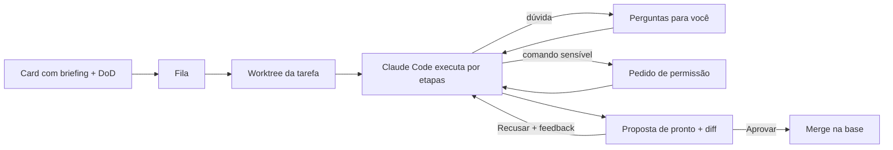

# AgentDeck

> Um kanban onde quem pega o card é o Claude Code, e quem decide se ficou pronto é você.

**Status:** ideia e especificação. O spike técnico (M0) foi validado; ainda não há código do produto.

## A ideia

Hoje, delegar uma tarefa a um agente de código é abrir um terminal, colar um prompt e ficar olhando. Se ele tiver uma dúvida, trava esperando você. Se pedir permissão, trava também. Quando termina, você tem que descobrir sozinho o que mudou e se está certo.

O AgentDeck transforma isso num quadro de tarefas:

1. Você escreve um card como escreveria para uma pessoa: **como está hoje**, **como deveria ficar**, **o que está fora do escopo** e uma **Definition of Done**.
2. Arrasta para a fila. O AgentDeck cria uma `git worktree` só para aquela tarefa e inicia o Claude Code nela.
3. Você acompanha pelo card: qual etapa ele está, uma barra de progresso, o último "estou fazendo X" e o chat ao vivo.
4. Se ele tiver dúvida, faz **perguntas com opções e uma recomendação**, e libera a vaga na fila enquanto você não responde.
5. Se precisar rodar algo sensível, aparece um **pedido de permissão** na sua caixa de entrada.
6. No fim, ele não "termina" sozinho: ele **propõe** que terminou, mostrando item por item da Definition of Done com a evidência. Você vê o diff e escolhe **Aprovar** (com ou sem merge) ou **Recusar com feedback**, que faz ele continuar de onde parou.

A conclusão é sempre humana.

Inspirado no [Truetask](https://truetask.io), mas pessoal: uma pessoa, uma máquina, rodando localmente.

## O que entra no MVP

- Boards kanban com listas de estado (aberto, em andamento, revisão, pronto, cancelado)
- Briefing estruturado, Definition of Done, checklist e dependências entre tarefas
- Execução isolada em `git worktree` por tarefa, numa branch `agentdeck/<KEY>`
- Workflows por etapas (Rápido, Padrão, Bug), com tentativas e "volta para a etapa X" em caso de falha
- Chat ao vivo, perguntas, pedidos de permissão e proposta de pronto com verificação
- Fila com limite de execuções simultâneas e detecção de execução travada
- Caixa de entrada "Precisa de você", juntando tudo que espera uma decisão sua

**Fora, por enquanto:** multiusuário, outros agentes (Codex, Cursor), integração com GitHub/PR, automações visuais.

## Como funciona por dentro

Um único processo Node faz servidor, fila e runner:

| Parte | Escolha |
|---|---|
| Runtime | Node 24 + TypeScript, sem build no servidor |
| Banco | `node:sqlite`, um arquivo em `~/.agentdeck/` |
| API | Hono, escutando só em `127.0.0.1` |
| Tempo real | Server-Sent Events |
| Agente | `@anthropic-ai/claude-agent-sdk`, com o login local do Claude Code |
| Ferramentas do agente | Servidor MCP in-process, uma instância por execução, presa àquela tarefa |
| Interface | React + Vite |

O agente conversa com o AgentDeck por ferramentas MCP próprias: lê o contexto da tarefa, avança etapas, registra o que fez, faz perguntas, atualiza a nota de trabalho e, no fim, chama `propose_done`. Nenhuma ferramenta permite que ele conclua a tarefa sozinho.

A especificação completa (modelo de dados, ciclo de vida, API, telas e marcos) está em **[docs/SPEC.md](docs/SPEC.md)**.

## Marcos

| # | Entrega | Status |
|---|---|---|
| M0 | Spike do SDK: login local, MCP in-process, permissões e `resume` | ✅ Validado |
| M1 | Núcleo do servidor: schema, CRUD e SSE | Pendente |
| M2 | Runner e ferramentas do agente | Pendente |
| M3 | Interface web | Pendente |
| M4 | Fila, dependências e recuperação | Pendente |
| M5 | Editor de workflows, notificações, acesso pelo celular | Depois |

## Aviso sobre autenticação

O AgentDeck usa o login do Claude Code que já existe na sua máquina, como se você rodasse `claude -p`. É pensado para **uso pessoal**. Ele não é, e não deve virar, um serviço que oferece o login de outras pessoas.
