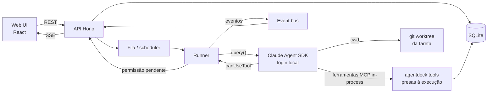
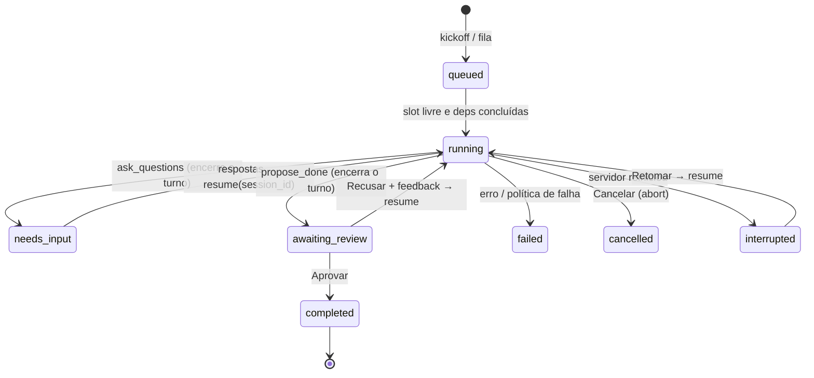

# AgentDeck — Spec do MVP

Ferramenta pessoal, inspirada no [Truetask](https://truetask.io), para delegar tarefas ao Claude Code rodando na minha máquina: kanban, briefing com Definition of Done, execução observável por etapas, perguntas, pedidos de permissão e aprovação humana.

## Escopo

**Dentro:** um usuário, uma máquina, Claude Code, boards kanban, briefing + DoD + checklist, execução em worktree git, chat ao vivo, perguntas, permissões, proposta de "pronto" com diff, fila com concorrência e dependências.

**Fora (por enquanto):** multiusuário/auth, cobrança, outros agentes (Codex/Cursor), visões além de kanban, bancos de dados/formulários/notas wiki, automações visuais, importadores, webhooks, integração GitHub/PR, IA embutida no app.

## Decisões

| Tema | Escolha | Motivo |
|---|---|---|
| Runtime | Node 24 + TypeScript (type stripping nativo) | Já instalado; servidor roda `.ts` sem build. |
| Banco | `node:sqlite`, arquivo em `~/.agentdeck/agentdeck.db` | Zero dependência nativa; um usuário. |
| HTTP | Hono + `@hono/node-server`, bind `127.0.0.1` | Pequeno, tipado. Sem auth porque só escuta localhost. |
| Tempo real | SSE (`GET /api/events`) | Unidirecional basta; comandos vão por REST. |
| Agente | `@anthropic-ai/claude-agent-sdk` (`query()`) | `canUseTool` para repassar permissões, MCP in-process, `resume` de sessão, `AbortController`. |
| Ferramentas do agente | MCP in-process (`createSdkMcpServer`), uma instância por execução, com as ferramentas `mcp__agentdeck__*` em `allowedTools` | A instância já está presa à tarefa/execução: o agente não enxerga outras tarefas e as ferramentas não precisam de `task_id`. Em `allowedTools` elas não passam pelo `canUseTool` (o SDK avisa com `CLAUDE_SDK_CAN_USE_TOOL_SHADOWED`, e é isso que se quer). |
| Isolamento | `git worktree` por tarefa em `~/.agentdeck/worktrees/<board>/<KEY>`, branch `agentdeck/<KEY>` | O repo principal nunca é tocado pelo agente. |
| Web | React + Vite (dev) servido como estático pelo mesmo processo (prod) | Um processo só. |

Tudo roda num processo `agentdeck` (servidor + runner + fila).

**Risco — autenticação.** O SDK usa o login local do Claude Code (assinatura); no spike, `init.apiKeySource` veio `none`, ou seja, sem API key. A política da Anthropic proíbe *terceiros oferecerem* login claude.ai em produtos; uso pessoal na própria máquina equivale a `claude -p`. Se isso mudar, o fallback é spawnar o CLI diretamente: `claude -p --output-format stream-json --input-format stream-json --mcp-config … --permission-prompt-tool …`, com o MCP exposto por HTTP local.

## Arquitetura



## Modelo de dados

```sql
boards(id, name, key_prefix, repo_path, base_branch, default_permission_mode, created_at)
lists(id, board_id, name, state CHECK(state IN ('open','in_progress','review','done','cancelled')), pos)
tasks(id, board_id, list_id, key UNIQUE, title,
      current_behavior, desired_behavior, out_of_scope,
      context_note,            -- memória de trabalho do agente, visível
      priority, pos, created_at, updated_at)
dod_items(id, task_id, text, pos)
checklist_items(id, task_id, text, done, evidence, pos)
task_deps(task_id, depends_on_id, PRIMARY KEY(task_id, depends_on_id))  -- ciclo rejeitado na escrita
comments(id, task_id, author CHECK(author IN ('human','agent')), body, created_at)

workflows(id, board_id NULL, name, when_to_use, steps_json, is_default)
  -- steps_json: [{key, name, instructions, retries, on_fail: 'fail' | {send_back: step_key}}]

runs(id, task_id, workflow_snapshot_json, status, current_step,
     session_id, worktree_path, branch, base_commit,
     permission_mode, model, effort,
     heartbeat_at, heartbeat_text, stalled, error,
     created_at, started_at, ended_at)
run_steps(run_id, key, status CHECK(status IN ('pending','active','done','failed','skipped','blocked')),
          attempts, summary, PRIMARY KEY(run_id, key))
run_log(id, run_id, ts, kind CHECK(kind IN ('plan','decision','command','evidence','blocker','artifact','note')),
        text, data_json)
run_events(id, run_id, ts, type, payload_json)   -- transcript bruto do SDK, alimenta o chat
questions(id, task_id, run_id, text, options_json, recommended, answer, status CHECK(status IN ('open','answered','dismissed')), created_at)
permission_requests(id, run_id, tool_name, input_json, status CHECK(status IN ('pending','allowed','denied','expired')),
                    always, created_at, decided_at)
proposals(id, run_id, summary, verification_json, server_flags_json,
          decision CHECK(decision IN ('pending','approved','declined')), feedback, created_at)
  -- verification_json: [{dod_item_id, status: 'met'|'unverified'|'failed', evidence}]
queue(task_id PRIMARY KEY, pos, added_at)
settings(key PRIMARY KEY, value)   -- concurrency, stall_minutes, permission_timeout_minutes
```

O "estado de atenção" da tarefa é derivado, não armazenado. Prioridade: `permission_pending` > `needs_input` > `proposed` > `failed` > `running` > `queued` > `idle`.

## Ciclo de uma execução



Regras:
- **Perguntas liberam o slot.** `ask_questions` grava as perguntas e manda o agente encerrar o turno. A execução fica em `needs_input` sem processo vivo. Responder retoma a sessão com `resume: session_id` e um prompt contendo as respostas. Recusar uma proposta usa o mesmo mecanismo.
- **Permissões seguram o slot.** `canUseTool` cria um `permission_request`, emite um evento SSE e aguarda a decisão na UI. Na metade do `permission_timeout`, a tarefa ganha um chip de atenção; no tempo total, a resposta é `deny` com mensagem e a execução vai para `needs_input`.
- **Travamento.** Sem heartbeat, passo, log ou mensagem do SDK por `stall_minutes` (padrão 30) → `stalled = 1` e alerta na UI. Qualquer atividade limpa a flag.
- **Reinício.** No boot, execuções `running` viram `interrupted`; o botão "Retomar" chama `resume`.
- **A conclusão é sempre humana.** Nenhuma ferramenta do agente conclui a tarefa. "Aprovar" move a tarefa para a lista de estado `done`.

## Modos de permissão

| Modo AgentDeck | `permissionMode` do SDK | `canUseTool` |
|---|---|---|
| Perguntar sempre | `default` | Tudo que cair em prompt vai para a UI. |
| Aceitar edições | `acceptEdits` | Comandos e o resto vão para a UI. |
| Autônomo | `auto` (classificador do Claude Code) | O que o classificador escalar vai para a UI. |

A worktree é o limite de trabalho, **não um sandbox**: o modo Autônomo continua podendo rodar comandos fora dela. Opções de UI para cada pedido: Permitir uma vez, Sempre permitir (vale até o fim da execução, via `updatedPermissions`), Negar com motivo.

## Ferramentas MCP (servidor `agentdeck`, in-process, presas à execução)

| Ferramenta | Entrada | Efeito |
|---|---|---|
| `task_context` | `{detail?: 'full' \| 'compact'}` | Briefing, DoD, checklist, comentários, nota de trabalho, perguntas respondidas, resumo das dependências concluídas, propostas recusadas com feedback, contrato do workflow (etapas + regras). |
| `heartbeat` | `{status}` | Atualiza `heartbeat_at/text`. |
| `step_update` | `{step_key, status, summary?, blocker?}` | Avança as etapas; `failed` aplica `retries`/`on_fail` no servidor e devolve o que fazer em seguida. |
| `log` | `{kind, text, data?}` | Adiciona ao `run_log`. |
| `ask_questions` | `{questions: [{text, options?, recommended?}]}` | Cria as perguntas, execução → `needs_input`; o retorno instrui a encerrar o turno. |
| `update_context_note` | `{content}` | Substitui `tasks.context_note`. |
| `checklist_set` | `{item_id, done, evidence?}` | Marca um item do checklist. |
| `comment` | `{body}` | Comentário como agente. |
| `propose_done` | `{summary, verification: [{dod_item_id, status, evidence}]}` | Cria a proposta, roda as checagens do servidor, execução → `awaiting_review`, instrui a encerrar o turno. |

Checagens do servidor anexadas à proposta (sinalizam, não bloqueiam): etapa ainda `pending`/`active`, item do checklist aberto, item do DoD sem verificação ou `unverified`, worktree com mudanças não commitadas, branch sem commits novos em relação a `base_commit`.

## Prompt da execução

- `systemPrompt: {type: 'preset', preset: 'claude_code', append: PROTOCOL}`. `PROTOCOL` vive em `server/protocol.md` e contém o ciclo: ler `task_context` → heartbeat a cada mudança de fase → seguir as etapas com `step_update` → perguntar em vez de chutar (um lote, com recomendação) → manter a nota de trabalho → verificar cada item do DoD → `propose_done`. "Out of scope" é obrigatório. Nunca encerrar com etapa ativa. Commitar na branch da worktree; nunca dar push nem merge.
- `settingSources: ['user', 'project']`, para que o `CLAUDE.md` do repo e as configs do usuário valham.
- Prompt de kickoff: `Trabalhe na tarefa {KEY} usando o workflow "{name}". Comece por task_context.`
- Prompt de retomada: respostas às perguntas ou feedback da recusa, e a instrução de chamar `task_context` de novo.

## Worktree e revisão

- Kickoff: `git -C repo worktree add -b agentdeck/<KEY> <path> <base_branch>`; `base_commit` é gravado. Uma nova execução da mesma tarefa reaproveita a worktree e a branch.
- A UI mostra `git diff base_commit...agentdeck/<KEY>` mais o diff da working tree, por arquivo.
- Na aprovação, a UI oferece **Merge na base** (`git merge --no-ff`, executado pelo servidor só depois do clique humano) ou **Só concluir**. Conflito → mostra o erro e não faz nada.
- Remover a worktree é uma ação explícita depois da conclusão.

## Fila

- Uma fila global ordenada (`queue.pos`) e `settings.concurrency` (padrão 2).
- O scheduler roda a cada mudança relevante e a cada 15 s. Pega o primeiro item cuja tarefa tenha todas as dependências em lista `done` e sem execução ativa, desde que existam slots livres (`running` com processo vivo).
- `needs_input` e `awaiting_review` não ocupam slot.
- A UI da fila permite responder, aprovar e recusar inline.

## API REST (resumo)

```
GET/POST        /api/boards            GET/PATCH/DELETE /api/boards/:id
POST            /api/boards/:id/lists  PATCH/DELETE     /api/lists/:id
GET             /api/boards/:id/tasks  POST /api/tasks  GET/PATCH/DELETE /api/tasks/:id
POST            /api/tasks/:id/move    {list_id, pos}
PUT             /api/tasks/:id/dod     PUT /api/tasks/:id/checklist   PUT /api/tasks/:id/deps
POST            /api/tasks/:id/comments
POST            /api/tasks/:id/runs    {workflow_id?, permission_mode?, model?, effort?}   -- kickoff
GET             /api/runs/:id          (inclui steps, log, events, questions, proposal)
POST            /api/runs/:id/cancel | /resume | /retry-step | /skip-step
POST            /api/questions/:id/answer {answer}   POST /api/questions/:id/dismiss
POST            /api/permissions/:id   {decision: 'allow'|'deny', always?, reason?}
POST            /api/proposals/:id/approve {merge: boolean}   POST /api/proposals/:id/decline {feedback}
GET             /api/runs/:id/diff
GET/PUT         /api/queue             PATCH /api/settings
GET             /api/inbox             -- tudo que precisa de mim
GET             /api/events            -- SSE: {type, board_id?, task_id?, run_id?, payload}
GET/POST/PATCH  /api/workflows
```

## Telas

1. **Board:** colunas por lista; card com chave, título, chip de atenção, barra de progresso segmentada por etapa e texto do heartbeat.
2. **Tarefa (drawer):** aba *Briefing* (3 seções, DoD, checklist, deps, nota de trabalho somente leitura) e aba *Chat* (transcript ao vivo com texto do agente, chamadas de ferramenta recolhíveis, cards de pergunta com opções, cards de permissão, card de proposta com verificação por item do DoD, flags do servidor, diff e Aprovar/Recusar). Barra da execução: etapa atual, Cancelar, Retomar, Repetir etapa, Pular etapa. Ao lado do botão Iniciar: modo de permissão, modelo e esforço.
3. **Fila:** lista ordenável com concorrência e ações inline.
4. **Inbox "Precisa de você":** permissões, perguntas e propostas de todos os boards.

## Workflows embutidos (seed)

- **Rápido:** `load` → `implement` → `verify` → `propose`.
- **Padrão:** `load` → `clarify` → `plan` → `implement` → `verify` (testes/lint) → `self_review` → `propose`.
- **Bug:** `load` → `reproduce` (teste falhando) → `root_cause` → `fix` → `verify` (mesma reprodução) → `propose`.

O snapshot do workflow é copiado para `runs.workflow_snapshot_json` no kickoff; editar o workflow depois não afeta execuções em andamento.

## Estrutura do repo

```
server/
  main.ts          boot: db, migrations, recovery, scheduler, http
  db.ts            node:sqlite + migrations (schema.sql)
  events.ts        bus em memória → SSE
  api/*.ts         rotas Hono
  runner.ts        query(), canUseTool, ciclo de vida, abort, stall
  tools.ts         createSdkMcpServer por execução
  checks.ts        checagens do servidor na proposta
  git.ts           worktree, diff, merge
  scheduler.ts     fila
  protocol.md
web/               Vite + React
```

## Marcos

| # | Entrega | Pronto quando |
|---|---|---|
| M0 ✅ | Spike do SDK | Validado com SDK 0.3.314 e Claude Code 2.1.314: login local (`apiKeySource: none`), MCP in-process `connected`, `canUseTool` chamado para `Write`, `resume` preserva a sessão e o contexto. |
| M1 | Núcleo do servidor | Schema, CRUD de board/lista/tarefa, SSE. |
| M2 | Runner + ferramentas | Kickoff via API cria a worktree, o agente percorre as etapas, pergunta, recebe resposta via `resume`, propõe; permissões resolvidas via API. |
| M3 | Web UI | Board, drawer, chat ao vivo, cards de pergunta/permissão/proposta, diff, aprovar com merge. |
| M4 | Fila | Concorrência, gate por dependência, stall, recovery no boot. |
| M5 | Depois | Editor de workflows, handoff entre etapas, MCP HTTP para criar tarefas a partir de sessões interativas, notificações (ntfy), acesso pelo celular via Tailscale. |
